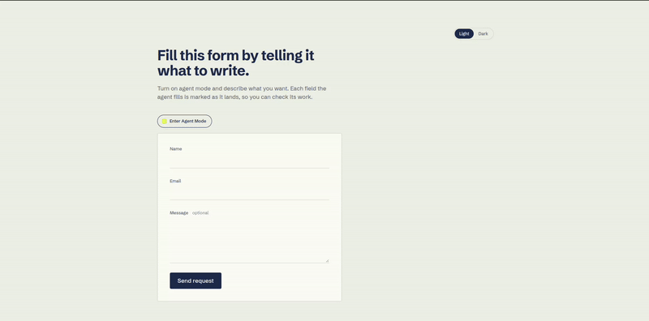
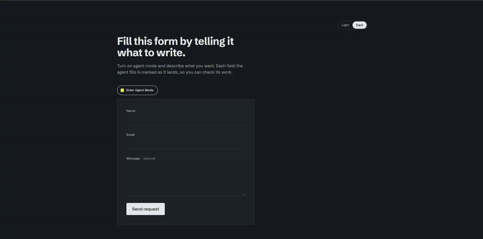

# AgenticFoo

`@ajeshajayan/agentic-foo-react` — a React component that adds an AI "agent mode" to any HTML form. Wrap your `<form>` in `<AgenticFoo>`, and users can fill it in by chatting: the agent reads the form's fields, asks for anything missing, and writes values straight into the inputs.

> **Status:** early development. The OpenAI/OpenRouter client runs in the browser, which exposes your API key. Use it for local development only (see [Security](#security)).
## Light mode
<picture>
  <source media="(prefers-color-scheme: light)" srcset="docs/demo-light.gif">
  
</picture>

## Dark mode
<picture>
  <source media="(prefers-color-scheme: dark)" srcset="docs/demo-dark.gif">
  
</picture>

## How it works

1. `AgenticFoo` inspects the `<form>` you pass as `children` and builds a system prompt describing every field (id, name, type, required, constraints, allowed values).
2. In agent mode, the user chats with the agent. Each message is sent along with the current form state.
3. The agent loop (`runAgent`) calls the model, which must answer with a tool call every turn:
   - `update_form` – set values on fields (applied directly to the DOM inputs)
   - `ask_user` – ask for missing or unclear information and pause for a reply
   - `finish` – stop and summarise what was done
   - any developer-defined tool (e.g. "fetch the signed-in user's details")
4. After each `update_form` the agent receives the fresh form state. The loop ends when the agent asks a question, finishes, the form is complete (all required fields filled, none invalid), or `maxSteps` (default 10) is hit.

## Usage

```tsx
import { AgenticFoo } from './lib/AgenticFoo';
import { defineTool } from './lib/agent';

const getUserDetails = defineTool({
  name: 'get_user_details',
  description: "Fetch the signed-in user's profile (name and email).",
  parameters: { type: 'object', properties: {}, additionalProperties: false },
  execute: async () => ({ name: 'Ada Lovelace', email: 'ada@example.com' }),
});

<AgenticFoo apiKey={key} model="openai/gpt-4o" tools={[getUserDetails]}>
  <form>
    <label htmlFor="name">Name</label>
    <input id="name" name="name" required />
    <label htmlFor="email">Email</label>
    <input id="email" name="email" type="email" required />
    <button type="submit">Submit</button>
  </form>
</AgenticFoo>
```

### Props

| Prop       | Type           | Description                                                                 |
| ---------- | -------------- | --------------------------------------------------------------------------- |
| `children` | `<form>`       | A single form element containing the fields to fill.                        |
| `apiKey`   | `string`       | API key for the model provider. Without it (or `model`) chat is disabled.   |
| `model`    | `string`       | Model id, e.g. `"openai/gpt-4o"`.                                           |
| `tools`    | `ToolSchema[]` | Optional developer tools the agent may call. Create them with `defineTool`. |
| `classNames` | `AgenticFooClassNames` | Optional class names per rendered element (see [Styling](#styling)). |
| `highlightDuration` | `number` | How long (ms) a field keeps `data-agent-updated` after the agent changes it. Default `1600`. |

### Styling

AgenticFoo ships **no CSS**, so it takes on your app's design. Style it in either of two ways:

- **`classNames`**: pass a class for any slot. Works with CSS modules, Tailwind or plain classes. Slots: `root`, `toolbar`, `toggle`, `formContainer`, `error`, `chat`, `log`, `hint`, `message` (every bubble), `userMessage`, `agentMessage`, `pending`, `notice`, `composer`, `input`, `send`, `updatedField`.
- **`data-agentic-foo` attributes**: every element carries `data-agentic-foo="<slot>"` (kebab-case, e.g. `form-container`). State is exposed too: the root has `data-mode="form" | "agent"` and `data-pending` while the agent runs, each message has `data-role="user" | "assistant"`, and the toggle has `aria-pressed`.

**Showing what the agent just filled.** When the agent changes a field, AgenticFoo adds `data-agent-updated` (and `classNames.updatedField`, if set) to that input for `highlightDuration` ms. Updating the same field again restarts it, so CSS animations replay. How it looks is up to you:

```css
/* Flash the input itself */
input[data-agent-updated],
textarea[data-agent-updated] {
  animation: just-filled 1.6s ease-out;
}
@keyframes just-filled {
  from { background-color: #fff59d; }
}

/* Or decorate the field wrapper */
.field:has([data-agent-updated]) label::after {
  content: " (filled by agent)";
}
```

See `playground/styles.css` for a complete example.

### Form requirements

- `children` must be a single `<form>` element.
- **Every field needs an `id`** (radio groups are keyed by `name`, with an `id` per radio). Missing ids throw an error.
- Only host elements (`input`, `textarea`, `select`) are discoverable; inputs hidden inside custom function/class components can't be seen from the element tree.
- Disabled fields are left untouched.

### Defining tools

A tool is a name, description, JSON Schema `parameters` (root must be `type: "object"`) and an `execute` function. Its return value (JSON-serialisable) is given back to the model. Names must be 1–64 letters, digits, `_` or `-`, unique, and must not clash with the built-ins (`update_form`, `ask_user`, `finish`). Invalid tools render an error in place of the form.

## Project structure

```
lib/
  AgenticFoo.tsx        Main component: form wrapper, agent mode toggle, wiring
  AgentChat.tsx         Chat UI (unstyled)
  types.ts              ChatMessage, FieldValue, FormUpdates, AgenticFooClassNames
  agent/
    runAgent.ts         Provider-independent agent loop
    builtinTools.ts     update_form / ask_user / finish
    toolSchema.ts       Developer tool -> wire format, tool validation
    openaiClient.ts     The only file importing `openai` (via OpenRouter)
    types.ts            ToolSchema, defineTool, wire types, AgentEvent
    index.ts            Public exports
  utils/
    formFields.ts           Extract fields from the React element tree
    buildSystemPrompt.ts    Form -> system prompt
    buildFormStateMessage.ts  Current values / missing / invalid summary
    applyFormUpdates.ts     Write agent values into the DOM form
    getFormError.ts         Validate `children`
    markUpdated.ts          Flag fields the agent just changed (`data-agent-updated`)
    cx.ts                   Join class names
playground/             Vite demo app (name / email / message form) and its styles.css
```

`runAgent` only depends on the `LLMClient` interface (`createCompletion({ messages, tools, signal })`), so the OpenAI client can be swapped for one that calls your backend.

## Development

Requires Node and [pnpm](https://pnpm.io).

```bash
pnpm install
```

Create `.env.local` (git-ignored):

```bash
VITE_OPENAI_API_KEY=your-key
VITE_OPENAI_MODEL=openai/gpt-4o
```

```bash
pnpm dev   # starts the playground via Vite
```

Open the playground, click **Enter Agent Mode**, and try "fill this in with my details".

## Security

`openaiClient.ts` uses `dangerouslyAllowBrowser: true` and talks to OpenRouter's OpenAI-compatible API directly from the browser, so the API key is visible to every visitor. Before production, implement `LLMClient` so it POSTs `{ messages, tools }` to your own backend, which calls the model and returns the assistant message.

## License

ISC
